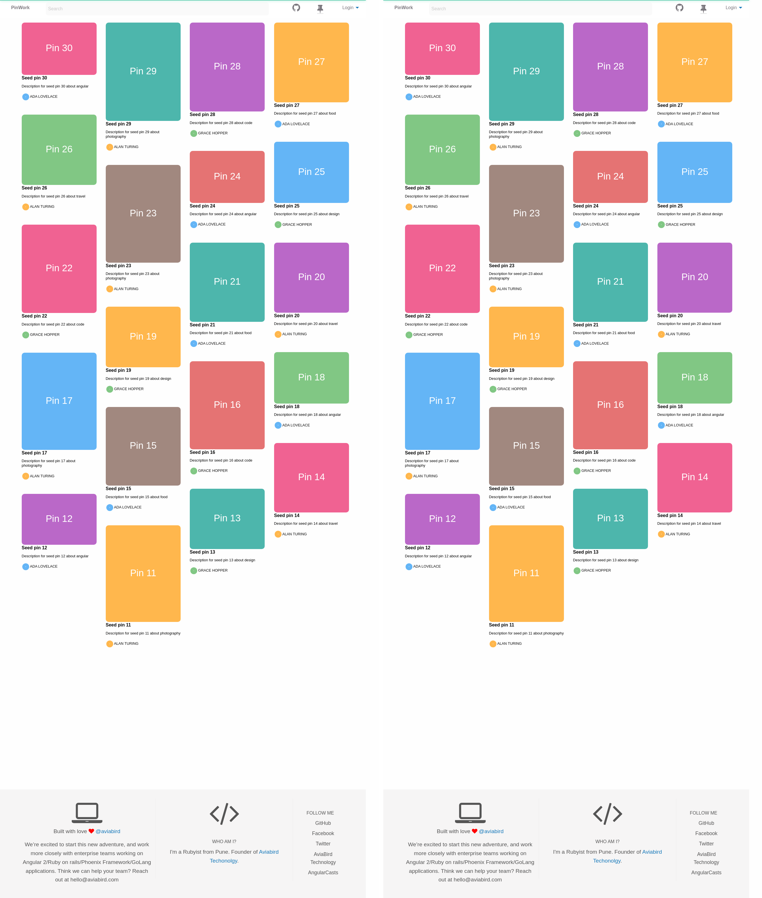
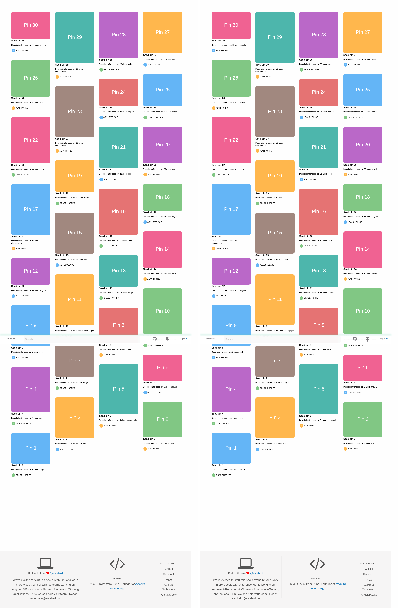
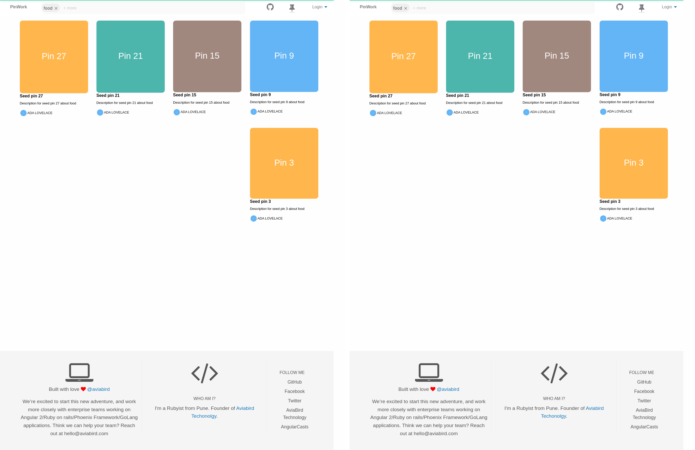
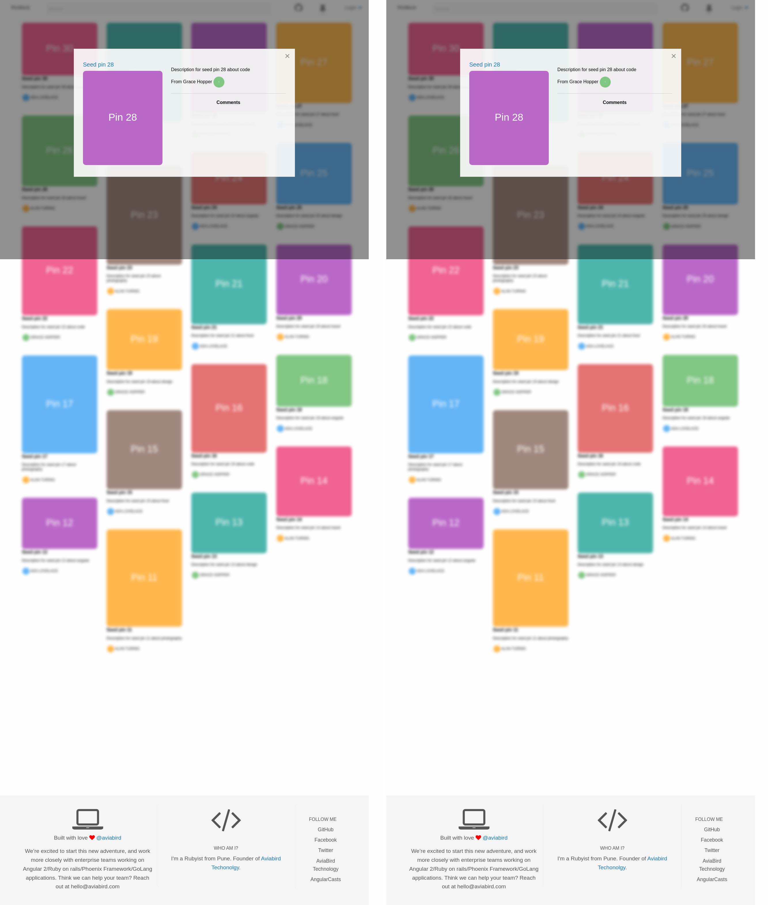
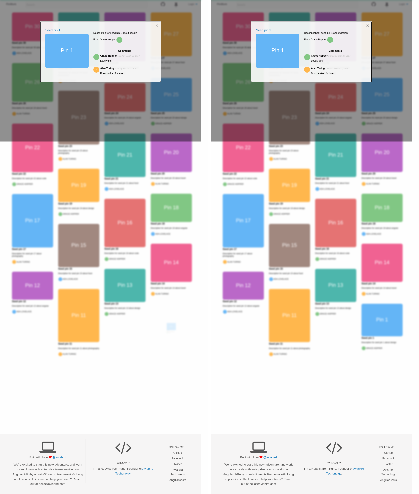
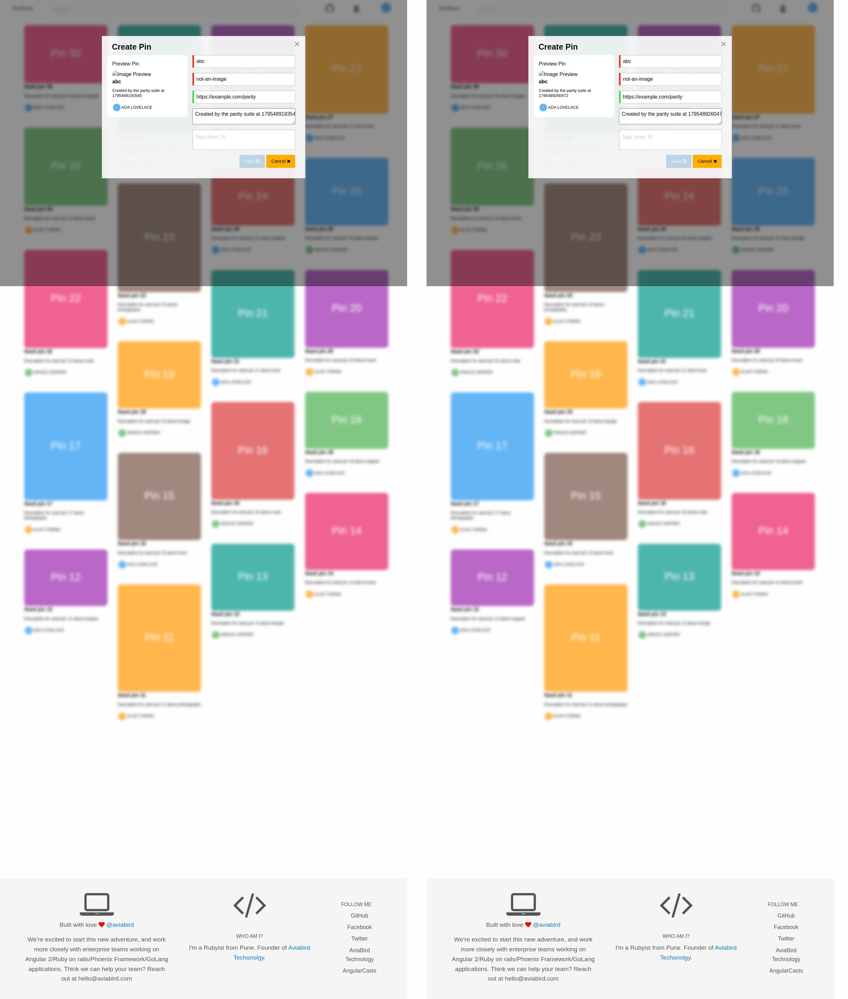
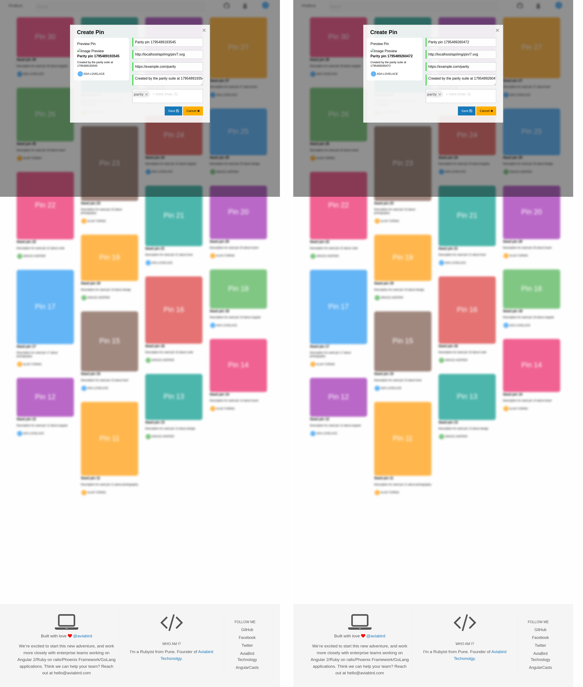
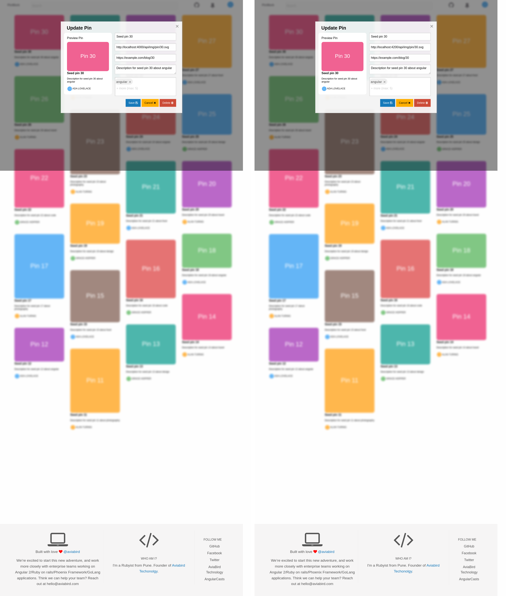
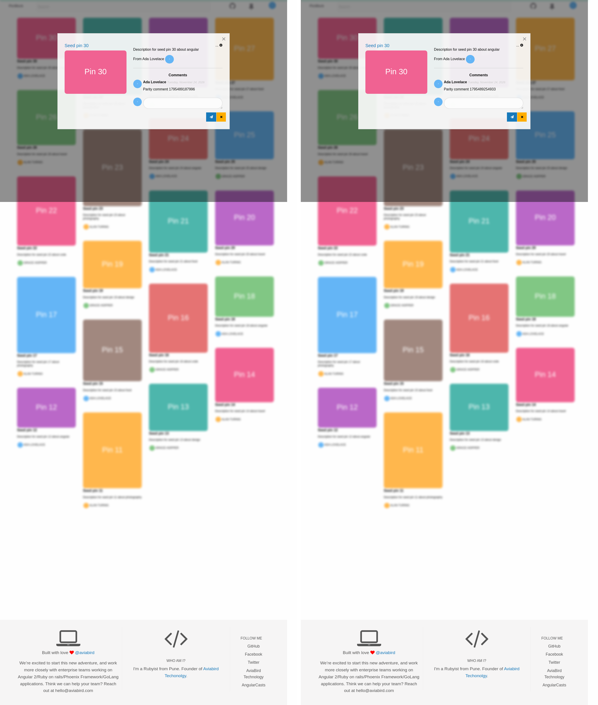

# Angular 21 upgrade parity report

Same Playwright specs run against the original Angular 4 app (`baseline`, :4000) and the upgraded app (`upgraded`, :4200), each backed by its own fresh mock API.

| Project | Passed | Failed |
|---|---|---|
| baseline | 12 | 0 |
| upgraded | 12 | 0 |

## Tests

| Test | Baseline | Upgraded |
|---|---|---|
| auth.spec.ts › signed out: "add a pin" starts sign-in in a popup window | pass | pass |
| auth.spec.ts › signed in: header shows avatar and the new-pin link; logout returns to signed-out header | pass | pass |
| browse.spec.ts › home: redirects to /pins and shows header, first page of pins and footer | pass | pass |
| browse.spec.ts › infinite scroll: scrolling to the bottom loads the next page | pass | pass |
| browse.spec.ts › search: filtering by tag shows only matching pins, removing the tag restores the list | pass | pass |
| browse.spec.ts › pin detail: clicking a pin opens the detail modal; closing returns to the grid | pass | pass |
| browse.spec.ts › pin detail deep link: loads the pin and its comments from the API | pass | pass |
| comments.spec.ts › comments: signed-in user adds a comment with Enter and deletes it | pass | pass |
| comments.spec.ts › comments: other users' comments have no delete button | pass | pass |
| pins-crud.spec.ts › create pin: validation keeps Save disabled until the form is valid, then the pin is added | pass | pass |
| pins-crud.spec.ts › edit and delete pin: owner can edit from the detail menu, then delete | pass | pass |
| pins-crud.spec.ts › non-owner sees no edit menu on someone else's pin | pass | pass |

## Screenshots (baseline left, upgraded right)

| Page | Pixel diff | Size (baseline / upgraded) |
|---|---|---|
| [01-home.png](side-by-side/01-home.png) | 0.00% | 1325x3142 / 1325x3142 |
| [02-infinite-scroll.png](side-by-side/02-infinite-scroll.png) | 0.00% | 1325x4073 / 1325x4073 |
| [03-search-food.png](side-by-side/03-search-food.png) | 0.00% | 1325x1728 / 1325x1728 |
| [04-pin-detail.png](side-by-side/04-pin-detail.png) | 0.00% | 1325x3142 / 1325x3142 |
| [05-pin-deep-link.png](side-by-side/05-pin-deep-link.png) | 1.45% | 1325x3142 / 1325x3142 |
| [06-signed-in.png](side-by-side/06-signed-in.png) | 0.00% | 1325x3142 / 1325x3142 |
| [07-create-invalid.png](side-by-side/07-create-invalid.png) | 0.01% | 1325x3142 / 1325x3142 |
| [08-create-valid.png](side-by-side/08-create-valid.png) | 0.02% | 1325x3142 / 1325x3142 |
| [09-edit.png](side-by-side/09-edit.png) | 0.00% | 1325x3142 / 1325x3142 |
| [10-comment-added.png](side-by-side/10-comment-added.png) | 0.00% | 1325x3142 / 1325x3142 |

### 01-home.png

### 02-infinite-scroll.png

### 03-search-food.png

### 04-pin-detail.png

### 05-pin-deep-link.png

### 06-signed-in.png

### 07-create-invalid.png

### 08-create-valid.png

### 09-edit.png

### 10-comment-added.png

